# SPIFFE gRPC registration: implementation guide

| | |
| --- | --- |
| **What this is** | How the SPIFFE gRPC registration for Open Cluster Management (OCM) is built: what each part does, why, and where the code is. |
| **Design** | Enhancement #199, `enhancements/enhancements/sig-architecture/199-spiffe-grpc-registration/` |
| **State** | Days 1 to 28 of the 30-day plan are done (2026-11-13). Days 29 and 30 are open; see [What is left](#9-what-is-left). |
| **Code** | Branch `spire` in five repositories: `api`, `sdk-go`, `ocm`, `addon-framework`, `clusteradm` |
| **Day by day** | [`../daily-plan.md`](../daily-plan.md) and [`../days/`](../days/) |

## Contents

1. [Summary](#1-summary)
2. [Words used in this document](#2-words-used-in-this-document)
3. [The requirements and how each one is met](#3-the-requirements-and-how-each-one-is-met)
4. [The big picture](#4-the-big-picture)
5. [Settings](#5-settings)
6. [Use cases](#6-use-cases)
   - [6.1 Set up the hub](#61-set-up-the-hub)
   - [6.2 Join a cluster](#62-join-a-cluster)
   - [6.3 Accept a cluster](#63-accept-a-cluster)
   - [6.4 Send work to a cluster](#64-send-work-to-a-cluster)
   - [6.5 Renew an SVID](#65-renew-an-svid)
   - [6.6 Deny a cluster or disable an add-on](#66-deny-a-cluster-or-disable-an-add-on)
   - [6.7 Delete a cluster](#67-delete-a-cluster)
   - [6.8 Run an add-on](#68-run-an-add-on)
   - [6.9 Choose an install mode](#69-choose-an-install-mode)
   - [6.10 Protect the agents' identities](#610-protect-the-agents-identities)
   - [6.11 Recover when a policy was changed](#611-recover-when-a-policy-was-changed)
   - [6.12 Clusters with their own SPIRE](#612-clusters-with-their-own-spire)
   - [6.13 Use your own SPIFFE ID layout](#613-use-your-own-spiffe-id-layout)
   - [6.14 Move an existing cluster to spiffe, and back](#614-move-an-existing-cluster-to-spiffe-and-back)
   - [6.15 Do it all with clusteradm](#615-do-it-all-with-clusteradm)
7. [Testing](#7-testing)
8. [Code map](#8-code-map)
9. [What is left](#9-what-is-left)
10. [Related documents](#10-related-documents)

---

## 1. Summary

OCM connects managed clusters to a hub. Today an agent on the managed cluster proves who it is
with a certificate or a token that OCM itself issues, and that credential is stored in a
Kubernetes Secret.

This work adds a new registration driver, `spiffe`. With it, the agents prove who they are with
an **SVID**, a short-lived identity document issued by **SPIRE**. OCM issues nothing and stores
nothing:

- The hub and every agent get their SVID from the SPIRE agent on their own node. It stays in
  memory.
- An agent connects to a new, separate port on the hub's gRPC server. Both sides show their SVID.
- SPIRE renews the SVIDs. OCM only replaces the connection.
- To cut an agent off, the hub closes its connection and refuses its identity. It does not need
  to talk to SPIRE.

It is a new driver next to the existing ones (`csr`, `awsirsa`, `grpc`), not a change to them. It
is behind the feature gate `SPIFFERegistration`, which is off by default.

## 2. Words used in this document

| Word | Meaning |
| --- | --- |
| **Hub** | The cluster that manages the others. |
| **Managed cluster** | A cluster that joins the hub. Also called a spoke. |
| **Agent** | An OCM program on the managed cluster. The *registration agent* joins the cluster to the hub; the *work agent* applies what the hub sends. |
| **Klusterlet** | The setting object, on the managed cluster, that describes the agents. The *Klusterlet operator* reads it and deploys them. |
| **ClusterManager** | The same for the hub. The *cluster-manager operator* reads it and deploys the hub. |
| **Add-on** | An extra program the hub installs on managed clusters. Its part on the managed cluster is the *add-on agent*. |
| **SPIRE** | Software that gives workloads an identity. It is installed and run by the platform team, not by OCM. |
| **SVID** | The identity document SPIRE gives a workload: a short-lived X.509 certificate with its key. |
| **SPIFFE ID** | The name inside an SVID, for example `spiffe://ocm-hub.example.org/ocm/cluster/cluster1/agent/work`. |
| **Trust domain** | The name of one SPIRE installation, the first part of a SPIFFE ID (`ocm-hub.example.org`). |
| **Workload API** | The socket in a pod through which the local SPIRE agent hands over the SVID. |
| **SPIRE entry** | A rule in SPIRE: "a pod in this namespace, with this ServiceAccount and this label, gets this SPIFFE ID". |
| **mTLS** | A TLS connection where both sides show a certificate. |
| **Admission policy** | A rule the Kubernetes API server checks on every request (`ValidatingAdmissionPolicy`). |
| **Finalizer** | A marker on an object that keeps it from being removed until the marker is taken off. |

## 3. The requirements and how each one is met

| Requirement | How it is met | Where |
| --- | --- | --- |
| A new gRPC registration, separate from `authType: grpc` | Its own driver value, its own listener and port, its own authenticator. The old listener is unchanged. | [6.1](#61-set-up-the-hub) |
| Only SVIDs for register, renew and revoke | The SPIFFE listener accepts nothing else; requests for a certificate or a token are refused there. | [4.2](#42-what-the-hub-checks-on-every-request) |
| SPIRE issues the SVIDs; OCM signs nothing | No signer, no CSR, no token in this mode. | [6.1](#61-set-up-the-hub), [6.2](#62-join-a-cluster) |
| Short-lived SVIDs, in memory only | The SVID is read from the Workload API by go-spiffe's `X509Source` and never written anywhere. | [6.5](#65-renew-an-svid) |
| No Secret or ConfigMap with keys or certificates | A SPIFFE-only hub and its agents create none. An integration test fails if one appears. | [7](#7-testing) |
| No contact with any service but the local SPIRE agent | Revocation and deletion are done on OCM's side, by closing connections and waiting. | [6.6](#66-deny-a-cluster-or-disable-an-add-on), [6.7](#67-delete-a-cluster) |
| All four install modes | The Klusterlet operator renders the agents for each mode. | [6.9](#69-choose-an-install-mode) |
| The same model for add-ons | Each add-on agent has its own SVID; no add-on credential is created. | [6.8](#68-run-an-add-on) |

## 4. The big picture

### 4.1 Components

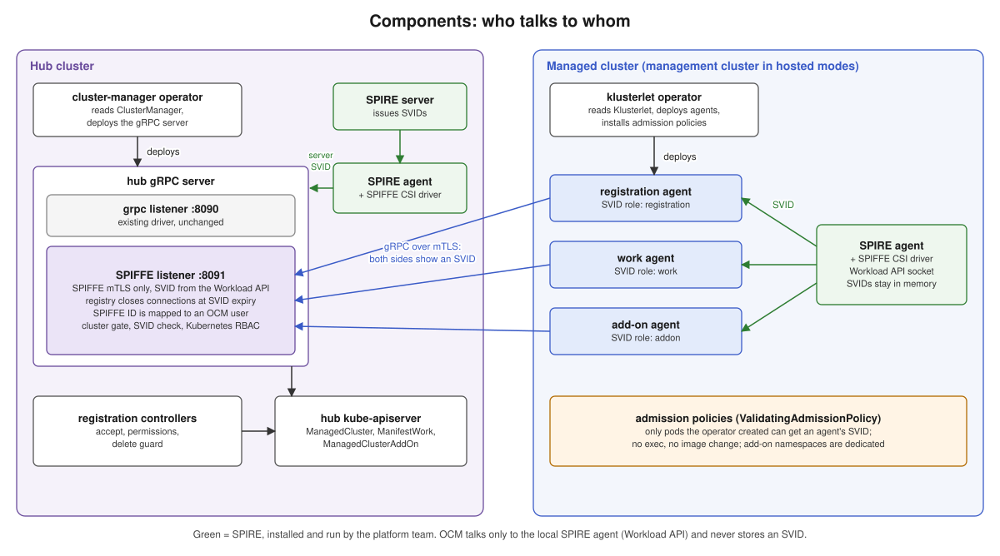

There are three groups of parts.

- **SPIRE** (green) gives out the identities. The platform team installs it and creates the
  SPIRE entries. OCM never creates an entry and never talks to the SPIRE server.
- **On the hub**, the gRPC server gets a second port, the *SPIFFE listener*. The cluster-manager
  operator turns it on. The hub's registration controllers get one new job, the *delete guard*.
- **On the managed cluster**, the agents get their SVID from the local SPIRE agent and connect
  to the hub with it. The Klusterlet operator deploys them and installs *admission policies*, so
  that only the pods it created can get an agent's identity.

### 4.2 What the hub checks on every request

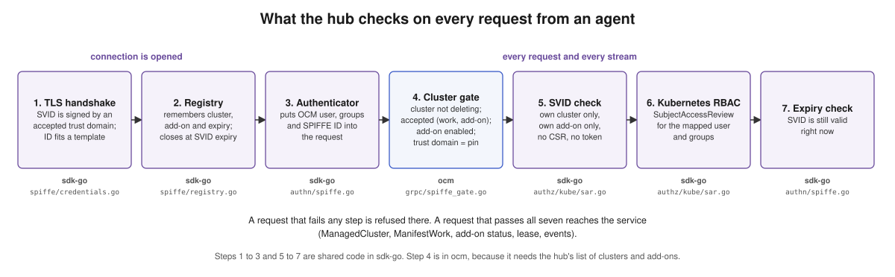

A request from an agent goes through seven checks. If one fails, the request is refused.

| # | Check | In simple words | Code |
| --- | --- | --- | --- |
| 1 | TLS handshake | Is the SVID signed by a SPIRE the admin listed, and does the ID look like an agent's ID? If not, the connection is dropped before anything is sent. | [`credentials.go`](../../sdk-go/pkg/server/grpc/spiffe/credentials.go#L53) |
| 2 | Registry | Remember this connection: which cluster, which add-on, when the SVID expires. Set a timer that closes it at that time. | [`registry.go`](../../sdk-go/pkg/server/grpc/spiffe/registry.go#L67) |
| 3 | Authenticator | Put the OCM user, the groups and the SPIFFE ID into the request, for the next checks. | [`authn/spiffe.go`](../../sdk-go/pkg/server/grpc/authn/spiffe.go#L57) |
| 4 | Cluster gate | Is the cluster being deleted? Is it accepted? Is the add-on still enabled? Does the SVID come from the trust domain the cluster is pinned to? | [`spiffe_gate.go`](../../ocm/pkg/server/grpc/spiffe_gate.go#L69) |
| 5 | SVID check | Is the request about the agent's own cluster, and for an add-on agent its own add-on? Is it a request for a certificate or a token? (Those are always refused.) If the cluster is denied, is it about anything but its `ManagedCluster`, lease or events? (Those are refused, whatever the role.) | [`sar.go`](../../sdk-go/pkg/cloudevents/server/grpc/authz/kube/sar.go#L247), [`checkDataType`](../../ocm/pkg/server/grpc/spiffe_gate.go#L118) |
| 6 | Kubernetes RBAC | The normal permission check on the hub, for the mapped user and groups. | same file |
| 7 | Expiry check | Is the SVID still valid at this moment? A second check behind the timer of step 2. | [`authn/spiffe.go`](../../sdk-go/pkg/server/grpc/authn/spiffe.go#L88) |

The gate is put in front of the normal authorizer in
[`options.go`](../../ocm/pkg/server/grpc/options.go#L130).

**One design change from the plan.** The authenticator was first meant to read the verified
certificate from the TLS state. go-spiffe checks the certificate in its own way and leaves that
field empty, so that authenticator would have refused every real agent. Now step 1 does the check
and hands the result on as a [`SPIFFEAuthInfo`](../../sdk-go/pkg/server/grpc/authn/spiffe.go#L28),
and step 3 accepts only that. The two must always be used together.

### 4.3 From a SPIFFE ID to an OCM identity

The hub reads who is calling from the SPIFFE ID and turns it into an OCM user and groups. These
are the same names OCM uses with the other drivers, so the permissions on the hub don't change.

| SPIFFE ID (default layout) | OCM user | OCM groups |
| --- | --- | --- |
| `.../ocm/cluster/<c>/agent/registration` | `system:open-cluster-management:<c>:registration` | `system:open-cluster-management:<c>`, `system:open-cluster-management:managed-clusters` |
| `.../ocm/cluster/<c>/agent/work` | `system:open-cluster-management:<c>:work` | same |
| `.../ocm/cluster/<c>/agent/klusterlet` | `system:open-cluster-management:<c>:klusterlet` | same |
| `.../ocm/cluster/<c>/addon/<a>/agent/<g>` | `system:open-cluster-management:cluster:<c>:addon:<a>:agent:<g>` | `system:open-cluster-management:cluster:<c>:addon:<a>`, `system:open-cluster-management:addon:<a>` |
| `.../ocm/hub/grpc-server` | The hub itself. Refused as a client. | |

Every identity also gets `system:authenticated`.

The mapping is done by [`IDScheme.Parse`](../../sdk-go/pkg/server/grpc/authn/spiffeid.go#L87). The
result is an [`OCMIdentity`](../../sdk-go/pkg/server/grpc/authn/spiffeid.go#L24): cluster name,
role, add-on name, agent name, trust domain, user and groups.

The layout of the IDs is not fixed. It is described by two **templates**, one for agents and one
for add-on agents; see [6.13](#613-use-your-own-spiffe-id-layout).

## 5. Settings

All settings are in the `api` repository. Nothing in them is secret: they are names, addresses
and durations.

### 5.1 The feature gate

`SPIFFERegistration`, alpha, off by default
([`feature.go`](../../api/feature/feature.go#L122)). It is added to the hub registration, spoke
registration, spoke work and add-on manager gate lists. While it is off, nothing changes.

### 5.2 On the hub: ClusterManager

[`SPIFFERegistrationConfig`](../../api/operator/v1/types_clustermanager.go#L219), used when a
registration driver has `authType: spiffe`.

| Field | Default | What it is for |
| --- | --- | --- |
| `trustDomain` | required | The hub's own SPIRE. The hub's SVID is in it. |
| `agentTrustDomains` | empty | The SPIREs the hub accepts agents from. The hub's own is always accepted, listed or not. |
| `serverSPIFFEID` | `spiffe://<trustDomain>/ocm/hub/grpc-server` | The ID the hub shows to agents. |
| `workloadAPISocket` | `unix:///spiffe-workload-api/spire-agent.sock` | Where the hub pod finds the SPIRE agent. |
| `maxSVIDLifetime` | `24h` | The longest an agent SVID can live. Used by the delete guard. |
| `maxClockSkew` | `5m` | How far clocks may differ. Used by the delete guard. |
| `agentIDTemplate` | `spiffe://{trustDomain}/ocm/cluster/{cluster}/agent/{role}` | Layout of agent IDs. |
| `addOnAgentIDTemplate` | `spiffe://{trustDomain}/ocm/cluster/{cluster}/addon/{addon}/agent/{agent}` | Layout of add-on agent IDs. |

Also new: the endpoint protocol `grpc-spiffe`
([`GRPCSPIFFEProtocol`](../../api/operator/v1/types_clustermanager.go#L164)), which says how the
SPIFFE port is exposed.

Three helpers read these settings, and all other code uses them instead of the raw fields:
[`GetAgentTrustDomains`](../../api/operator/v1/funcs_clustermanager.go#L15) (adds the hub's own
trust domain), [`GetAgentIDTemplate`](../../api/operator/v1/funcs_clustermanager.go#L33) and
[`GetAddOnAgentIDTemplate`](../../api/operator/v1/funcs_clustermanager.go#L42) (fall back to the
defaults).

```yaml
apiVersion: operator.open-cluster-management.io/v1
kind: ClusterManager
metadata:
  name: cluster-manager
spec:
  registrationConfiguration:
    featureGates:
    - feature: SPIFFERegistration
      mode: Enable
    registrationDrivers:
    - authType: spiffe
      spiffe:
        trustDomain: ocm-hub.example.org
        agentTrustDomains:
        - east.example.org
  serverConfiguration:
    endpointsExposure:
    - protocol: grpc-spiffe
      grpc:
        type: loadBalancer
```

### 5.3 On the managed cluster: Klusterlet

[`KlusterletSPIFFEConfig`](../../api/operator/v1/types_klusterlet.go#L295), used when the
registration driver has `authType: spiffe`.

| Field | Default | What it is for |
| --- | --- | --- |
| `hubEndpoint` | required | Address of the hub's SPIFFE port. |
| `hubSPIFFEID` | required | The only ID the agents accept from the hub. |
| `trustDomain` | the trust domain of `hubSPIFFEID` | The agents' own SPIRE. |
| `workloadAPISocket` | `unix:///spiffe-workload-api/spire-agent.sock` | Where the agent pods find the SPIRE agent. |
| `agentIDTemplate`, `addOnAgentIDTemplate` | same defaults as the hub | Must equal the hub's. |

Rules the API server enforces on the Klusterlet:

- `spiffe` settings are required when `authType` is `spiffe`.
- The add-on driver must be `spiffe` too. Otherwise OCM would create add-on credentials.
- `clusterName` is required, because it is part of the agent's ID.
- The templates must contain `{cluster}` and `{role}` (agents), or `{cluster}`, `{addon}` and
  `{agent}` (add-ons).

```yaml
apiVersion: operator.open-cluster-management.io/v1
kind: Klusterlet
metadata:
  name: klusterlet
spec:
  clusterName: cluster1
  deployOption:
    mode: Default
  registrationConfiguration:
    registrationDriver:
      authType: spiffe
      spiffe:
        hubEndpoint: ocm-grpc.hub.internal:443
        hubSPIFFEID: spiffe://ocm-hub.example.org/ocm/hub/grpc-server
    addOnKubeClientRegistrationDriver:
      authType: spiffe
```

### 5.4 What the Klusterlet reports back

[`KlusterletSPIFFEStatus`](../../api/operator/v1/types_klusterlet.go#L583), under `status.spiffe`:

| Field | What it holds | Who reads it |
| --- | --- | --- |
| `admissionPolicies` | Name, UID and generation of each policy and binding the operator installed. | The operator, to notice a change ([6.11](#611-recover-when-a-policy-was-changed)). |
| `addOnNamespace` | Name and UID of the add-on namespace the operator created. | The operator, so recovery cleans only that one. |
| `agentIDs` | The exact SPIFFE ID of each agent, per role. | The platform team, to create the SPIRE entries. |

And the condition
[`SPIFFEAdmissionReady`](../../api/operator/v1/types_klusterlet.go#L579): True when the policies
are in place and recorded. Only then is it safe to create the SPIRE entries.

### 5.5 Other additions

| Addition | Where | Purpose |
| --- | --- | --- |
| Annotation `open-cluster-management.io/spiffe-trust-domain` | [`cluster/v1/types.go`](../../api/cluster/v1/types.go#L294) | Pins a `ManagedCluster` to one trust domain. |
| Add-on driver value `spiffe` | `addon/v1alpha1` and `addon/v1beta1` `types_managedclusteraddon.go` | Marks an add-on as using its own SVID. |

**A limit of the API server.** Two checks on the ClusterManager could not be written as CRD
rules: that `serverSPIFFEID` is in `trustDomain`, and that the templates use the right
placeholders. Kubernetes limits how expensive a CRD's rules may be, and these go over the limit
because the drivers are in a list with no maximum size. The cluster-manager operator does these
checks ([6.1](#61-set-up-the-hub)).

## 6. Use cases

Each use case says what the person does, what happens, why it is built this way, and where the
code and tests are.

### 6.1 Set up the hub

**Who:** the hub admin, with the platform team.

**What they do**

1. The platform team runs a SPIRE server outside the clusters and a SPIRE agent with the SPIFFE
   CSI driver on the hub. It creates a SPIRE entry for the gRPC server pod with the ID
   `spiffe://<trustDomain>/ocm/hub/grpc-server`.
2. The admin turns the feature gate on and adds a `spiffe` driver to the `ClusterManager`
   ([5.2](#52-on-the-hub-clustermanager)), or runs `clusteradm init`
   ([6.15](#615-do-it-all-with-clusteradm)).

**What happens**

The cluster-manager operator reads the `ClusterManager` and:

- starts the gRPC server with the SPIFFE listener on port 8091 and mounts the SPIRE agent's
  socket into the pod through the `csi.spiffe.io` volume;
- creates the Service `<cluster-manager>-grpc-server-spiffe` (ClusterIP on 8091, or a load
  balancer on 443 when the `grpc-spiffe` exposure says so) and opens the port in the hub's
  network policy;
- passes `maxSVIDLifetime` and `maxClockSkew` to the registration controllers;
- gives new agents the one permission they need before they are accepted: to create and read
  `ManagedCluster` objects.

When `spiffe` is the only gRPC driver, it does **not** create the old `grpc` listener, its
Service, its serving certificate or its config. So a SPIFFE-only hub has no Secret with a key, a
certificate or a token.

When the gRPC server starts, the SPIFFE listener reads its own SVID from the Workload API. It
refuses to start if the trust domain, the server ID or a template is wrong, or if SPIRE has no
SVID with the server's ID.

**Why**

- *A separate listener.* A mistake in the new code can't weaken the old driver, and the old
  driver's tokens and certificates can't be used on the new port.
- *Fail at start.* A hub that starts and then refuses every agent is much harder to understand
  than one that says at once what is wrong.
- *Checks in the operator.* The checks the CRD couldn't do run in the operator. If one fails, it
  deploys nothing for SPIFFE and writes the reason on the `ClusterManager`
  (`Applied=False`, reason `InvalidSPIFFEConfiguration`). The admin sees the mistake where they
  made it.
- *The pre-acceptance permission.* With the other drivers a bootstrap token gives this. Here
  there is no bootstrap step, so the permission goes to the group every SPIFFE agent is in, and
  the listener still limits each agent to the cluster named in its SVID.

**Code**

| Part | Where |
| --- | --- |
| Listener flags and start | [`spiffe_listener.go`](../../ocm/pkg/server/grpc/spiffe_listener.go#L48): `AddFlags`, [`complete`](../../ocm/pkg/server/grpc/spiffe_listener.go#L76) (checks), [`runSPIFFEListener`](../../ocm/pkg/server/grpc/spiffe_listener.go#L113) |
| Turning the old listener off | `--grpc-enabled` in [`options.go`](../../ocm/pkg/server/grpc/options.go#L69) |
| Server can take other credentials | [`WithTransportCredentials`](../../sdk-go/pkg/server/grpc/server.go#L77), [`WithInterceptors`](../../sdk-go/pkg/server/grpc/server.go#L83); the old file-based path is unchanged in [`certFileCredentials`](../../sdk-go/pkg/server/grpc/server.go#L184) |
| Server credentials from SPIRE | [`NewServerCredentials`](../../sdk-go/pkg/server/grpc/spiffe/credentials.go#L29) |
| Operator: read settings, check them | [`helpers.SPIFFEConfig`](../../ocm/pkg/operator/helpers/helpers.go#L1064), [`SPIFFEServerID`](../../ocm/pkg/operator/helpers/helpers.go#L1099), [`fillSPIFFEConfig`](../../ocm/pkg/operator/operators/clustermanager/controllers/clustermanagercontroller/clustermanager_controller.go#L619) |
| Operator: what it deploys | [`grpc-server/deployment.yaml`](../../ocm/manifests/cluster-manager/management/grpc-server/deployment.yaml#L68), [`service-spiffe.yaml`](../../ocm/manifests/cluster-manager/hub/grpc-server/service-spiffe.yaml), [`spiffe-agent-clusterrole.yaml`](../../ocm/manifests/cluster-manager/hub/grpc-server/spiffe-agent-clusterrole.yaml), [`config.go`](../../ocm/manifests/config.go#L58) |

Flags of the SPIFFE listener: `--spiffe-enabled`, `--spiffe-listen-address`,
`--spiffe-trust-domain`, `--spiffe-agent-trust-domains`, `--spiffe-server-id`,
`--spiffe-workload-api-socket`, `--spiffe-agent-id-template`, `--spiffe-addon-agent-id-template`.

**Tests:** [`spiffe_listener_test.go`](../../ocm/pkg/server/grpc/spiffe_listener_test.go)
(SPIFFE only, both listeners together, no server SVID, bad settings),
[`clustermanager_spiffe_test.go`](../../ocm/pkg/operator/operators/clustermanager/controllers/clustermanagercontroller/clustermanager_spiffe_test.go)
(what the operator renders).

### 6.2 Join a cluster

**Who:** the managed cluster's admin, with the platform team.

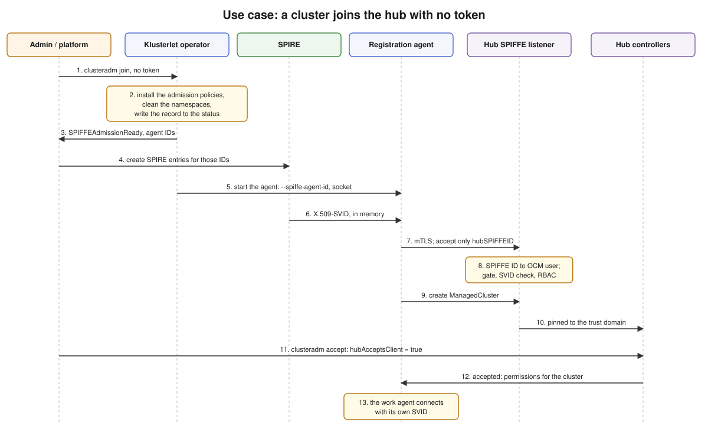

**What they do**

1. Create a `Klusterlet` with `authType: spiffe` ([5.3](#53-on-the-managed-cluster-klusterlet)),
   or run `clusteradm join`. No token is needed.
2. Wait until the Klusterlet reports `SPIFFEAdmissionReady=True`.
3. Create the SPIRE entries for the IDs listed in `status.spiffe.agentIDs`.

**What happens**

1. The Klusterlet operator installs the admission policies, cleans the agent namespace and writes
   the record to the status ([6.10](#610-protect-the-agents-identities)). Only then does it start
   the agents.
2. It builds each agent's SPIFFE ID from the template and passes it to the agent with
   `--spiffe-agent-id`. It mounts the SPIRE agent's socket and no hub credential Secret.
3. The registration agent waits until SPIRE gives it the SVID with that ID.
4. It connects to the hub's SPIFFE port. It accepts only the hub's exact SPIFFE ID.
5. It creates its `ManagedCluster`. The hub pins the cluster to the trust domain of the SVID.

**Why**

- *No bootstrap.* With the other drivers the agent starts from a bootstrap kubeconfig, asks for a
  certificate and saves it in a Secret. Here the SVID is the only credential, so those parts of
  the agent are not started at all.
- *Entries after `SPIFFEAdmissionReady`.* Before the policies are in place, anyone who can start
  a pod with the right label and ServiceAccount would get the agent's SVID.
- *The operator builds the ID.* The agent has no template code, so it can't end up with a
  different idea of its ID than the operator and the SPIRE entry have.
- *Pick the SVID by ID.* SPIRE can give one pod several SVIDs. An agent takes the one with the
  expected ID, never "the first one", because the order can change. If it is missing, the error
  names the expected ID and the IDs that did arrive.
- *Accept only the hub's exact ID.* Otherwise any workload in the hub's trust domain could
  pretend to be the hub.

**Code**

| Part | Where |
| --- | --- |
| Pick the SVID by ID | [`NewX509Source`](../../sdk-go/pkg/spiffe/source.go#L43), [`ErrSVIDNotFound`](../../sdk-go/pkg/spiffe/source.go#L17), [`Ready`](../../sdk-go/pkg/spiffe/source.go#L91) |
| Agent's connection to the hub | [`NewSPIFFEGRPCOptions`](../../sdk-go/pkg/cloudevents/generic/options/grpc/spiffeoptions.go#L35) |
| The driver | [`SPIFFEDriver`](../../ocm/pkg/registration/register/spiffe/spoke_driver.go#L30): [`Secretless`](../../ocm/pkg/registration/register/spiffe/spoke_driver.go#L66), [`BuildClients`](../../ocm/pkg/registration/register/spiffe/spoke_driver.go#L106) |
| "No Secret" drivers | `SecretlessDriver` in [`register/interface.go`](../../ocm/pkg/registration/register/interface.go); used in [`spokeagent.go`](../../ocm/pkg/registration/spoke/spokeagent.go#L263) to skip the bootstrap and Secret controllers |
| Client building shared with `grpc` | [`NewCloudEventsClients`](../../ocm/pkg/registration/register/grpc/clients.go#L28) |
| Agent flags | [`common/spiffe/options.go`](../../ocm/pkg/common/spiffe/options.go#L43): `--spiffe-hub-endpoint`, `--spiffe-hub-id`, `--spiffe-agent-id`, `--spiffe-workload-api-socket` |
| Pinning at create | [`pinTrustDomain`](../../ocm/pkg/server/services/cluster/cluster.go#L185) |

**Tests:**
[`spoke_driver_test.go`](../../ocm/pkg/registration/register/spiffe/spoke_driver_test.go),
[`source_test.go`](../../sdk-go/pkg/spiffe/source_test.go),
[`spiffeoptions_test.go`](../../sdk-go/pkg/cloudevents/generic/options/grpc/spiffeoptions_test.go),
integration: "the registration agent joins with its SVID only"
([`spokecluster_spiffe_test.go`](../../ocm/test/integration/registration/spokecluster_spiffe_test.go#L302)).

### 6.3 Accept a cluster

**Who:** the hub admin.

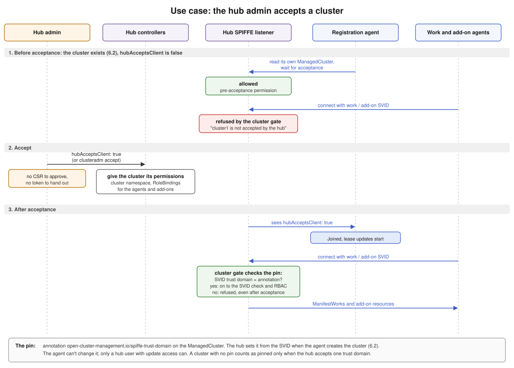

**What they do:** set `hubAcceptsClient: true` on the `ManagedCluster`, or run
`clusteradm accept --clusters <name>`. That is all. There is no certificate request to approve
and no token to hand out, because the agents already have their SVIDs.

**What happens**

1. *Before acceptance.* The cluster already exists: the registration agent created it when it
   joined ([6.2](#62-join-a-cluster)). The registration agent may read its own `ManagedCluster`
   to see when it is accepted. The work agent and the add-on agents are refused at the cluster
   gate with `cluster <name> is not accepted by the hub`. In the singleton modes the one agent is
   let in, but its work and add-on requests are refused the same way
   ([6.6](#66-deny-a-cluster-or-disable-an-add-on)).
2. *Acceptance.* The hub's controllers give the cluster its permissions, the same as with the
   other drivers: the cluster namespace and the RoleBindings for its agents and add-ons.
3. *After acceptance.* The registration agent sees `hubAcceptsClient: true`, marks the cluster
   joined and starts updating its lease. The work agent and the add-on agents connect again,
   and this time the gate lets them through to the SVID check and RBAC.

On every request after this, the gate also checks the cluster's *pin*: the trust domain of the
SVID must be the trust domain the cluster is pinned to.

**The pin**

The pin is the annotation `open-cluster-management.io/spiffe-trust-domain` on the
`ManagedCluster`. Its value is a trust domain, for example `ocm-hub.example.org`.

| Question | Answer |
| --- | --- |
| Who sets it? | The hub, when the registration agent creates the cluster. It uses the trust domain of the agent's SVID and ignores any value the agent sent. |
| Can the agent change it? | No. The hub keeps the old value on every update from an agent. Only a hub user with update access to the `ManagedCluster` can change it. |
| What does it block? | An SVID for this cluster from any other trust domain. The gate refuses it, before and after acceptance. |
| What if a cluster has no pin? | For example, a cluster that joined with another driver and moved to `spiffe`. If the hub accepts only one trust domain, the cluster counts as pinned to it. If the hub accepts several, the agents are refused until an admin sets the annotation. |
| What does `clusteradm accept --spiffe-trust-domain` do? | It refuses to accept a cluster pinned to a different trust domain, and pins a cluster that has no pin. |

**Why**

- *Why the gate refuses the work and add-on agents before acceptance.* RBAC alone isn't enough:
  when a cluster is denied, the hub keeps the cluster's RoleBindings, so a denied cluster's
  agents would still pass RBAC. The registration agent is not refused, because it has to see
  when the cluster is accepted again.
- *Why the pin.* The hub can trust several SPIRE servers, each with its own trust domain. The
  OCM user comes from the path of the SVID (`/ocm/cluster/<name>/...`), not from the trust
  domain. Without the pin, the admin of one SPIRE could issue an SVID with the name of a cluster
  that belongs to another SPIRE and take that cluster over.

**Code**

| Part | Where |
| --- | --- |
| Set the pin, keep it on updates | [`pinTrustDomain`](../../ocm/pkg/server/services/cluster/cluster.go#L185), [`cluster.go`](../../ocm/pkg/server/services/cluster/cluster.go#L109) |
| The gate: acceptance, pin, deletion, add-on | [`clusterGate.check`](../../ocm/pkg/server/grpc/spiffe_gate.go#L69) |
| clusteradm | [`spiffeAcceptance`](../../clusteradm/pkg/cmd/accept/spiffe.go#L18) |

**Tests:** [`cluster_spiffe_test.go`](../../ocm/pkg/server/services/cluster/cluster_spiffe_test.go),
[`spiffe_gate_test.go`](../../ocm/pkg/server/grpc/spiffe_gate_test.go),
e2e `check-deny.sh` (a denied cluster stops receiving work).

### 6.4 Send work to a cluster

**Who:** a hub user who creates a `ManifestWork` in the cluster's namespace.

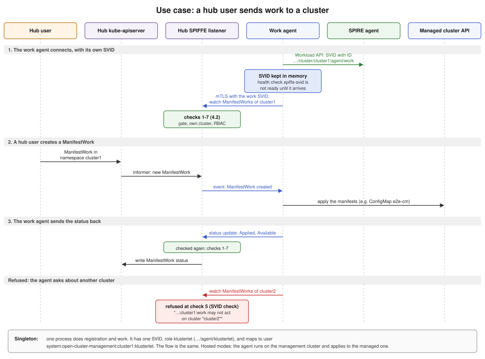

**What they do:** create the `ManifestWork`, as with any other driver. Nothing about it is
SPIFFE-specific.

**What happens**

1. *The work agent connects with its own SVID.* It asks the local SPIRE agent (Workload API) for
   the SVID with its ID, `.../ocm/cluster/cluster1/agent/work`, and keeps it in memory. It opens
   an mTLS connection to the hub's SPIFFE listener with that SVID and watches the
   `ManifestWork`s of its cluster. The listener runs checks 1 to 7
   ([4.2](#42-what-the-hub-checks-on-every-request)) before it lets the watch start.
2. *The hub sends the work.* The hub user creates the `ManifestWork` in namespace `cluster1`.
   The listener sees it through its informer and sends it to the work agent as an event on the
   open watch. The agent applies the manifests on the managed cluster.
3. *The agent sends the status back.* It sends `Applied`, `Available` and any status feedback
   to the listener. The listener runs the same checks again and writes the status to the
   `ManifestWork` on the hub.

If the work agent of `cluster1` asks for anything about `cluster2`, the listener refuses it at
check 5: `system:open-cluster-management:cluster1:work may not act on cluster "cluster2"`.

**Install modes**

| Mode | Who does the work | SVID |
| --- | --- | --- |
| `Default` | the work agent | role `work`, user `system:open-cluster-management:<c>:work` |
| `Singleton` | one process does registration and work | role `klusterlet`, user `system:open-cluster-management:<c>:klusterlet` |
| `Hosted`, `SingletonHosted` | as above, but the agent runs on the management cluster and applies to the managed cluster | as above |

**Why**

- *Its own SVID.* With the `grpc` driver, the registration agent writes the hub credentials into
  a Secret and the work agent reads them. Here the two agents share nothing, so no Secret is
  needed.
- *Checked on every request.* A valid SVID proves the caller is the work agent of `cluster1`. It
  doesn't stop it from asking about `cluster2`. So the hub compares every request with the
  cluster in the SVID (check 5).
- *Health check.* The work agent's `spiffe-svid` health check is not ready while the SVID with
  its ID is missing, and it names the expected ID and the IDs that did arrive. An admin sees at
  once that the SPIRE entry is missing.

**Code**

| Part | Where |
| --- | --- |
| Work agent connection with its SVID | [`work/spoke/spokeagent.go`](../../ocm/pkg/work/spoke/spokeagent.go#L220) |
| Health check `spiffe-svid` | [`HealthCheckers`](../../ocm/pkg/work/spoke/spokeagent.go#L306) |
| Own cluster only, no certificates or tokens | [`authorizeSPIFFE`](../../sdk-go/pkg/cloudevents/server/grpc/authz/kube/sar.go#L247) |

**Tests:** [`sar_spiffe_test.go`](../../sdk-go/pkg/cloudevents/server/grpc/authz/kube/sar_spiffe_test.go),
integration: "the work agent applies ManifestWorks with its own SVID"
([line 370](../../ocm/test/integration/registration/spokecluster_spiffe_test.go#L370)).

### 6.5 Renew an SVID

**Who:** nobody. SPIRE does it.

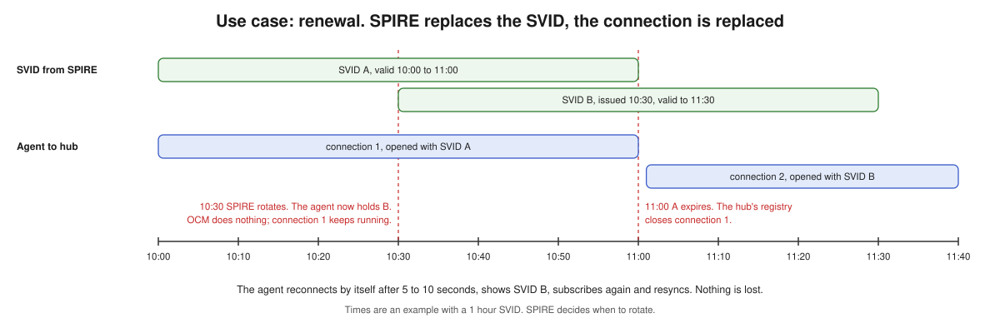

**What happens**

1. SPIRE gives the agent a new SVID before the old one expires. The agent now holds both; the
   open connection keeps using the old one.
2. When the old SVID expires, the hub's registry closes the connection.
3. The agent reconnects by itself, shows the new SVID, subscribes again and resyncs.

**Why**

- *OCM does nothing.* This is the point of the design. No renewal request, no new credential to
  store.
- *The timer.* TLS checks a certificate only once, when the connection is opened. Without the
  timer, an agent could open a connection with a valid SVID and keep using it for days after the
  SVID expired. With it, a connection never lives longer than the SVID it was opened with.
- *No new client code.* Each new connection reads the current SVID from the Workload API. The
  existing client already reconnects on its own; the first retry is after 5 to 10 seconds.

**Code:** timer in [`Registry.track`](../../sdk-go/pkg/server/grpc/spiffe/registry.go#L67); second
check in the [expiry interceptors](../../sdk-go/pkg/server/grpc/authn/spiffe.go#L88).

**Tests:** [`registry_test.go`](../../sdk-go/pkg/server/grpc/spiffe/registry_test.go),
[`spiffe_renewal_test.go`](../../sdk-go/pkg/cloudevents/generic/options/v2/grpc/spiffe_renewal_test.go),
e2e rotation check ([`check-rotation.sh`](../../ocm/test/e2e/spiffe/check-rotation.sh)).

**Known limit:** with SVIDs that live less than 10 minutes, the client's wait between reconnects
grows, and an update can arrive up to about a minute late. Nothing is lost. It does not happen
with one-hour SVIDs (`questions.md` Q18).

### 6.6 Deny a cluster or disable an add-on

**Who:** the hub admin.

**What they do:** set `hubAcceptsClient: false` on a cluster, or delete a `ManagedClusterAddOn`.

**What happens**

| Admin action | The hub closes | The gate then refuses |
| --- | --- | --- |
| Cluster goes from accepted to denied | all of the cluster's SPIFFE connections | its work agent and add-on agents; and from any agent, every request except its `ManagedCluster`, lease and events |
| Cluster is being deleted | all of the cluster's SPIFFE connections | all of its agents |
| Add-on is removed from a cluster | only that add-on's connections on that cluster | that add-on's agents |

Other clusters are not affected.

**Why**

- *Two steps.* Closing makes the cut fast. But the agent's SVID is still valid, and it reconnects
  within seconds. The gate makes the cut stay.
- *No call to SPIRE.* OCM may contact only the local SPIRE agent, so it can't ask SPIRE to take
  an SVID back. It stops accepting the identity on its own side.
- *Refused by role, and by what is asked.* The gate runs before the request is read, so it can
  only refuse by the role in the SVID. In the singleton modes one agent, with one SVID, is both
  the registration and the work agent, so the gate has to let it in. A second check runs once
  the request is read and refuses a denied cluster's work and add-on requests whatever the role,
  so the singleton agent gets no work either.
- *The registration agent keeps basic access when a cluster is denied.* It has to see when the
  cluster is accepted again.
- *A new cluster is not cut off.* It was never accepted, and it still has to create its
  `ManagedCluster` and wait.

**Code:** [`clusterRevocationHandler`](../../ocm/pkg/server/grpc/revocation.go#L22),
[`addOnRevocationHandler`](../../ocm/pkg/server/grpc/revocation.go#L52),
[`CloseCluster`](../../sdk-go/pkg/server/grpc/spiffe/registry.go#L107),
[`CloseAddOn`](../../sdk-go/pkg/server/grpc/spiffe/registry.go#L116),
[`clusterGate.check`](../../ocm/pkg/server/grpc/spiffe_gate.go#L69),
[`checkAddOn`](../../ocm/pkg/server/grpc/spiffe_gate.go#L137),
[`checkDataType`](../../ocm/pkg/server/grpc/spiffe_gate.go#L118),
[`WithSPIFFECheck`](../../sdk-go/pkg/cloudevents/server/grpc/authz/kube/sar.go#L84).

**Tests:** [`revocation_test.go`](../../ocm/pkg/server/grpc/revocation_test.go),
[`spiffe_gate_test.go`](../../ocm/pkg/server/grpc/spiffe_gate_test.go), integration: "is cut off
when the cluster is denied"
([line 211](../../ocm/test/integration/registration/spokecluster_spiffe_test.go#L211)), e2e
[`check-deny.sh`](../../ocm/test/e2e/spiffe/check-deny.sh).

**Found by the e2e test:** the first version relied on the hub removing a denied cluster's
permissions. But the hub keeps one permission for the work agent, so it reconnected and kept
receiving work. The gate now refuses the work agent and add-on agents of a cluster that is not
accepted (ocm `2bdd76cff`).

**Found in review:** in the singleton modes the one agent kept receiving work while its cluster
was denied: the gate let it in as the registration agent, and RBAC still allowed work. The hub
now also refuses a denied cluster's requests by their data type: only its `ManagedCluster`, lease
and events are allowed (sdk-go `284a8c71`, ocm `05f6b541b`). e2e `check-deny.sh` passes for
`Singleton`, `Hosted` and `SingletonHosted`.

### 6.7 Delete a cluster

**Who:** the hub admin.

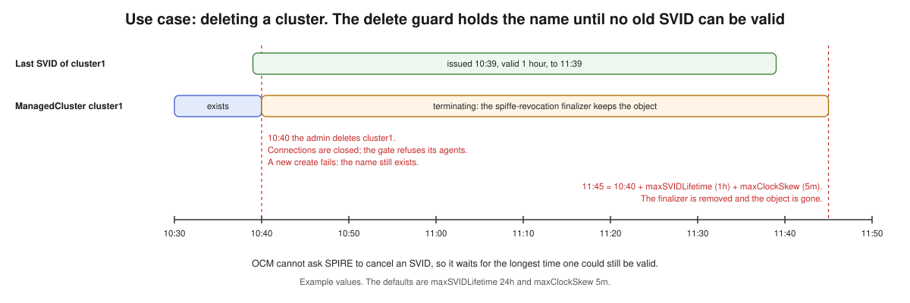

**What they do:** remove the cluster's SPIRE entries first, then delete the `ManagedCluster`.

**What happens:** the hub keeps the object in the "terminating" state until
`deletion time + maxSVIDLifetime + maxClockSkew`. During that time the cluster's connections are
closed, the gate refuses its agents, and the name can't be used for a new cluster. Then the
object is removed. The rest of the cleanup (permissions, content on the hub) happens at once as
before; only the empty object waits.

**Why:** a new agent is allowed to create its own `ManagedCluster`. An agent on the deleted
cluster may still hold an SVID that is valid for hours, and could use it to create the cluster
again. OCM can't ask SPIRE to cancel that SVID, so it waits until it can't be valid any more.

**Which clusters are held:** clusters pinned to a trust domain, and every cluster when `spiffe`
is the hub's only driver. This choice is still to be confirmed in review (`questions.md` Q11).

**Code:** [`deleteguard.go`](../../ocm/pkg/registration/hub/spiffe/deleteguard.go#L78)
(finalizer [`open-cluster-management.io/spiffe-revocation`](../../ocm/pkg/registration/hub/spiffe/deleteguard.go#L23),
[`guards`](../../ocm/pkg/registration/hub/spiffe/deleteguard.go#L70)); started in
[`hub/manager.go`](../../ocm/pkg/registration/hub/manager.go) with the flags
`--spiffe-max-svid-lifetime` and `--spiffe-max-clock-skew`.

**Tests:** [`deleteguard_test.go`](../../ocm/pkg/registration/hub/spiffe/deleteguard_test.go),
integration: "can't recreate a deleted cluster until the delete guard releases it"
([line 238](../../ocm/test/integration/registration/spokecluster_spiffe_test.go#L238)).

### 6.8 Run an add-on

**Who:** a hub user who enables an add-on; the add-on's author.

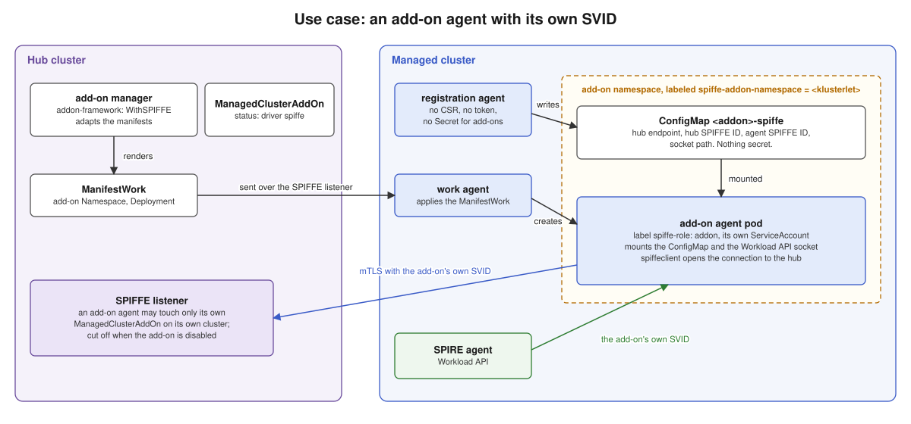

**What happens**

1. On the hub, the add-on manager adjusts the add-on's manifests for `spiffe` clusters. The
   author doesn't have to change them.
   - Where the add-on would mount the Secret `<addon>-hub-kubeconfig`, it mounts the ConfigMap
     `<addon>-spiffe`, under the same name and path.
   - The pods get the SPIRE agent's socket and the label `spiffe-role: addon`.
   - The add-on's namespace is created with the dedicated add-on label.
2. On the managed cluster, the registration agent creates **no** certificate request, token or
   Secret for the add-on. It writes the ConfigMap `<addon>-spiffe` with four values: the hub's
   address, the hub's SPIFFE ID, the add-on agent's own SPIFFE ID and the socket path.
3. The add-on agent reads these, gets its own SVID from SPIRE and connects to the hub.
4. The hub lets it touch only its own `ManagedClusterAddOn` on its own cluster.

**Why**

- *Its own SVID.* The same model as the agents: no add-on credential is created or stored.
- *A ConfigMap is allowed.* Nothing in it is secret. It holds addresses and names, no keys and no
  certificates (`questions.md` Q8).
- *Dedicated namespaces.* In a shared namespace, other pods could get the add-on's identity.

**What is refused, with a reason on the add-on**

| Case | Reason | Why |
| --- | --- | --- |
| The add-on asks for a certificate from a custom signer | `CustomSignerNotSupported` | Nothing signs certificates in this mode. |
| The install namespace has no dedicated add-on label | `AddOnNamespaceNotDedicated` | Other pods there could get the add-on's identity. |
| The add-on asks for a user or group an SVID doesn't map to | `SubjectNotSupportedBySPIFFE` | The identity on the hub comes from the SVID and is fixed. |

**Code**

| Part | Where |
| --- | --- |
| Registration agent: no credentials, write the ConfigMap | [`startSPIFFERegistration`](../../ocm/pkg/registration/spoke/addon/registration_controller.go#L356), [`writeSPIFFEConfig`](../../ocm/pkg/registration/spoke/addon/registration_controller.go#L440) |
| Framework: adjust manifests | [`WithSPIFFE`](../../addon-framework/pkg/agent/spiffe.go#L186), [`ApplySPIFFE`](../../addon-framework/pkg/agent/spiffe.go#L61), [`applySPIFFEToPod`](../../addon-framework/pkg/agent/spiffe.go#L142) |
| Framework: subject check | [`SubjectCarriedBySVID`](../../addon-framework/pkg/agent/spiffe.go#L205), used in [`registration/controller.go`](../../addon-framework/pkg/addonmanager/controllers/registration/controller.go) |
| Helper for add-on authors | [`spiffeclient.LoadConfig`](../../addon-framework/pkg/spiffeclient/client.go#L33), [`NewGRPCOptions`](../../addon-framework/pkg/spiffeclient/client.go#L60) |
| Klusterlet name for the namespace label | annotation [`agent.open-cluster-management.io/klusterlet-name`](../../ocm/pkg/operator/operators/klusterlet/controllers/klusterletcontroller/klusterlet_controller.go#L61) on the `ManagedCluster` |

**Tests:** [`registration_spiffe_test.go`](../../ocm/pkg/registration/spoke/addon/registration_spiffe_test.go),
[`agent/spiffe_test.go`](../../addon-framework/pkg/agent/spiffe_test.go),
[`spiffeclient/client_test.go`](../../addon-framework/pkg/spiffeclient/client_test.go),
integration: "an add-on agent acts for its own add-on only, until the add-on is disabled"
([line 428](../../ocm/test/integration/registration/spokecluster_spiffe_test.go#L428)).

### 6.9 Choose an install mode

All four Klusterlet install modes work. They differ in where the agents run and how many there
are. The enhancement has a diagram of this
([modes](../../enhancements/enhancements/sig-architecture/199-spiffe-grpc-registration/spiffe-grpc-registration-modes.svg)).

Each mode has its own guide, from setup to deletion: [Default](mode-default.md),
[Singleton](mode-singleton.md), [Hosted](mode-hosted.md),
[SingletonHosted](mode-singletonhosted.md).

| Mode | Agents | Runs in | ServiceAccount | `spiffe-role` |
| --- | --- | --- | --- | --- |
| `Default` | registration agent | agent namespace on the managed cluster | `<klusterlet>-registration-sa` | `registration` |
| `Default` | work agent | same | `<klusterlet>-work-sa` | `work` |
| `Singleton` | one agent | same | `<klusterlet>-work-sa` | `klusterlet` |
| `Hosted` | registration agent | namespace named after the Klusterlet, on the management cluster | `<klusterlet>-registration-sa` | `registration` |
| `Hosted` | work agent | same | `<klusterlet>-work-sa` | `work` |
| `SingletonHosted` | one agent | same | `<klusterlet>-work-sa` | `klusterlet` |

**What the operator does in every mode**

- Builds each agent's SPIFFE ID from the template and passes it with `--spiffe-agent-id`.
  `{namespace}` is the namespace the pods really run in, because that is what the SPIRE entry
  selects on.
- Puts the `spiffe-role` label on the pods. SPIRE picks pods by namespace, ServiceAccount and
  label, so the label lets the platform team write one entry per role.
- Mounts the SPIRE agent's socket, and no bootstrap or hub kubeconfig Secret.
- Writes the IDs into `status.spiffe.agentIDs`.
- If a template is invalid, deploys no agents and writes the reason on the Klusterlet
  (`InvalidSPIFFEConfiguration`).

Two old habits were removed for this mode: the operator used to stop the work agent and report a
problem when the hub kubeconfig Secret was missing. With `spiffe` that Secret never exists. It
now reports `HubConnectionDegraded=False` with reason `HubConnectionSPIFFE`.

**Code:** [`fillSPIFFEConfig`](../../ocm/pkg/operator/operators/klusterlet/controllers/klusterletcontroller/klusterlet_controller.go#L799),
the three Deployment templates in
[`manifests/klusterlet/management/`](../../ocm/manifests/klusterlet/management/),
[`spiffeRolePairs`](../../ocm/pkg/operator/operators/klusterlet/controllers/klusterletcontroller/spiffe_admission.go#L528),
[`klusterlet_ssar_controller.go`](../../ocm/pkg/operator/operators/klusterlet/controllers/ssarcontroller/klusterlet_ssar_controller.go#L106).

**Tests:** [`klusterlet_spiffe_test.go`](../../ocm/pkg/operator/operators/klusterlet/controllers/klusterletcontroller/klusterlet_spiffe_test.go)
(one case per mode), e2e in all four modes ([7.3](#73-end-to-end-tests)).

### 6.10 Protect the agents' identities

**Who:** the Klusterlet operator, automatically.

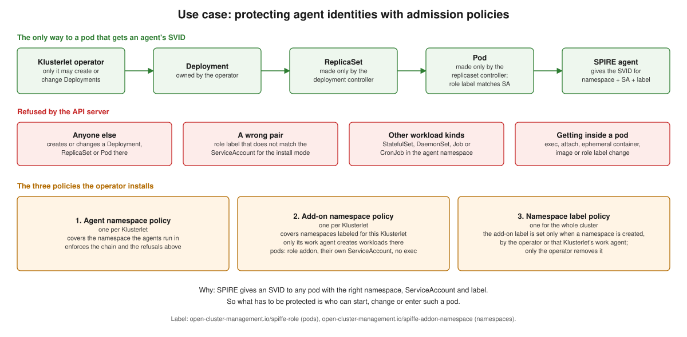

**The risk.** SPIRE gives an agent's SVID to any pod with the right namespace, ServiceAccount and
label. So anyone who can start such a pod gets the agent's identity. With the other drivers the
credential is in a Secret, and reading the Secret is what has to be protected. Here, starting
pods is what has to be protected.

**What the operator installs**, before any agent runs:

| Policy | Covers | Rules |
| --- | --- | --- |
| Agent namespace policy (one per Klusterlet) | The namespace the agents run in | Only the operator creates or changes Deployments. Pods come only from those, through Kubernetes' own controllers. The role label must match the ServiceAccount for the install mode. No StatefulSet, DaemonSet, Job or CronJob. No `exec`, `attach`, debug container, image change or role label change on agent pods. |
| Add-on namespace policy (one per Klusterlet) | Namespaces labeled for this Klusterlet | Only this Klusterlet's work agent creates workloads. Add-on pods have the role `addon` and their own ServiceAccount, never an agent's. The same "no exec" rules. |
| Namespace label policy (one for the cluster) | Every namespace | The add-on label can only be set when a namespace is created, and only by the operator or that Klusterlet's work agent. Only the operator can remove it. |

**Why each rule**

- *No exec, attach or image change.* Each would put someone's own code inside a pod that has an
  agent's SVID. The rule applies to everyone, including a cluster admin. Reading logs still
  works.
- *The label rule.* The label is what says "pods here may get add-on identities". Without the
  rule, someone could put it on an existing namespace such as `default`, and the pods already
  there could ask for add-on identities.
- *One Klusterlet per label value.* In the hosted modes one management cluster carries several
  Klusterlets. The label value keeps them apart.
- *No policy API, no agents.* If the cluster doesn't support `ValidatingAdmissionPolicy`, the
  operator deploys no agents and reports `SPIFFEAdmissionPolicyUnavailable`.

**Code** (all in
[`spiffe_admission.go`](../../ocm/pkg/operator/operators/klusterlet/controllers/klusterletcontroller/spiffe_admission.go)):
[`agentAdmissionPolicy`](../../ocm/pkg/operator/operators/klusterlet/controllers/klusterletcontroller/spiffe_admission.go#L173),
[`addOnAdmissionPolicy`](../../ocm/pkg/operator/operators/klusterlet/controllers/klusterletcontroller/spiffe_admission.go#L198),
[`namespaceLabelPolicy`](../../ocm/pkg/operator/operators/klusterlet/controllers/klusterletcontroller/spiffe_admission.go#L230),
[`policyAPIServed`](../../ocm/pkg/operator/operators/klusterlet/controllers/klusterletcontroller/spiffe_admission.go#L319).
The policies are built in Go, not from YAML files.

**Tests:** [`spiffe_admission_envtest_test.go`](../../ocm/pkg/operator/operators/klusterlet/controllers/klusterletcontroller/spiffe_admission_envtest_test.go#L35)
runs the policies in a real API server and acts as the operator, the built-in controllers, the
work agent and an ordinary user.

### 6.11 Recover when a policy was changed

**Who:** the Klusterlet operator, automatically.

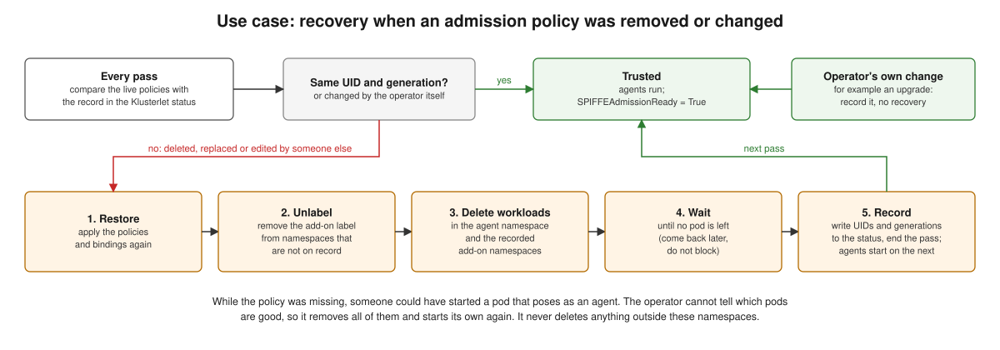

**What happens.** The operator writes into `status.spiffe.admissionPolicies` the UID and the
generation of each policy and binding it installed. On every pass it compares the live objects
with this record.

- **Same:** the namespaces are trusted. The agents run and `SPIFFEAdmissionReady` is True.
- **Changed by the operator itself** (for example after an upgrade): it records the new state.
  No recovery.
- **Deleted, replaced or edited by someone else:** it runs recovery, in five steps:
  1. Restore the policies and bindings.
  2. Remove the add-on label from namespaces that are not on record.
  3. Delete every workload in the agent namespace and the recorded add-on namespaces.
  4. Wait until no pod is left.
  5. Write the new record and end the pass. The agents start on the next pass.

**Why**

- *Delete everything.* While the policy was missing, someone could have started a pod that poses
  as an agent. The operator can't tell a good pod from a bad one.
- *The status is the only record.* Nothing is kept in memory, so this also works after the
  operator restarts.
- *Limited reach.* Recovery never deletes anything outside the agent namespace and the recorded
  add-on namespaces. The operator creates the add-on namespace with the label only when it
  doesn't exist; it never labels a namespace that is already there
  (`AddOnNamespaceNotDedicated`).

**Code:** [`reconcile`](../../ocm/pkg/operator/operators/klusterlet/controllers/klusterletcontroller/spiffe_admission.go#L356),
[`recover`](../../ocm/pkg/operator/operators/klusterlet/controllers/klusterletcontroller/spiffe_admission.go#L426),
[`trustedAddOnNamespaces`](../../ocm/pkg/operator/operators/klusterlet/controllers/klusterletcontroller/spiffe_admission.go#L594),
[`unlabelUntrusted`](../../ocm/pkg/operator/operators/klusterlet/controllers/klusterletcontroller/spiffe_admission.go#L628),
[`deleteWorkloads`](../../ocm/pkg/operator/operators/klusterlet/controllers/klusterletcontroller/spiffe_admission.go#L653),
[`ensureAddOnNamespace`](../../ocm/pkg/operator/operators/klusterlet/controllers/klusterletcontroller/spiffe_admission.go#L681),
[`storeSPIFFEStatus`](../../ocm/pkg/operator/operators/klusterlet/controllers/klusterletcontroller/klusterlet_controller.go#L654).

**Tests:** [`spiffe_admission_test.go`](../../ocm/pkg/operator/operators/klusterlet/controllers/klusterletcontroller/spiffe_admission_test.go),
e2e (a deleted policy is restored and the agents are replaced within 6 seconds).

**Found by the e2e tests**

| Problem | Fix |
| --- | --- |
| A failed status write lost the record. The operator started the agents and deleted them again in a loop. | Recovery ends the pass after recording; the SPIFFE status fields are written again on a conflict (ocm `9b2cd94bd`). |
| Deleting a Klusterlet left its policies behind. | The cleanup controller removes them (ocm `8d1a4d175`, [`klusterlet_cleanup_controller.go`](../../ocm/pkg/operator/operators/klusterlet/controllers/klusterletcontroller/klusterlet_cleanup_controller.go#L175)). |
| A deleted policy went unnoticed for up to five minutes. | The operator watches the policies and bindings (ocm `301d209f2`, [`options.go`](../../ocm/pkg/operator/operators/klusterlet/options.go#L113), [`spiffeAdmissionQueueKeys`](../../ocm/pkg/operator/operators/klusterlet/controllers/klusterletcontroller/klusterlet_controller.go#L888)). |

**Known limit:** the operator watches policies only on the cluster it runs on. In the hosted
modes, the policies on the managed cluster are checked every five minutes (`questions.md` Q20).

### 6.12 Clusters with their own SPIRE

**Who:** a platform team that runs a separate SPIRE per cluster or region.

**What they do**

1. Federate the hub's SPIRE with the other SPIRE, so each side has the other's trust bundle.
2. Add the other trust domain to `agentTrustDomains` on the `ClusterManager`.
3. Set `trustDomain` on that cluster's `Klusterlet` to the agents' own trust domain.
   `hubSPIFFEID` stays the hub's ID.

**What happens:** the hub accepts an agent SVID only from a listed trust domain, even when its
SPIRE trusts more. Each cluster is pinned to one trust domain ([6.3](#63-accept-a-cluster)).
When a trust domain is taken off the list, the hub can close all its connections.

**Why:** managed clusters often have their own SPIRE. The hub must only trust the ones the admin
named, and one trusted SPIRE must not be able to act for another's cluster.

**Code:** [`authorizeMemberOfAny`](../../sdk-go/pkg/server/grpc/spiffe/credentials.go#L36),
[`GetAgentTrustDomains`](../../api/operator/v1/funcs_clustermanager.go#L15),
[`CloseTrustDomain`](../../sdk-go/pkg/server/grpc/spiffe/registry.go#L128),
[`clusterGate.check`](../../ocm/pkg/server/grpc/spiffe_gate.go#L69).

**Tests:** federation case in
[`spiffeoptions_test.go`](../../sdk-go/pkg/cloudevents/generic/options/grpc/spiffeoptions_test.go)
(agent in `east.example.org`, hub in `ocm-hub.example.org`),
[`spiffe_gate_test.go`](../../ocm/pkg/server/grpc/spiffe_gate_test.go). The e2e environment
uses one trust domain, so this is not covered end to end yet.

### 6.13 Use your own SPIFFE ID layout

**Who:** a company that already has naming rules for SPIFFE IDs.

**What they do:** set `agentIDTemplate` and `addOnAgentIDTemplate` on the `ClusterManager`, and
the **same** values on every `Klusterlet`. For example:

```text
spiffe://{trustDomain}/k8s/{cluster}/ns/{namespace}/ocm/{role}
```

**Template rules, and why**

| Rule | Why |
| --- | --- |
| Starts with `spiffe://{trustDomain}/` | The trust domain is checked against the list, never read from the path. |
| Each placeholder fills a whole path part and appears once | There is only one way to read an ID. |
| At least one part is fixed text | A template can't match every ID in a trust domain. |
| No ID may match both templates | The hub must be able to tell an agent from an add-on. |
| The hub's own ID matches neither | An agent can never show up with the hub's identity. |
| `{namespace}` is optional and never used for permissions | The hub has no way to check it. |

Required placeholders: `{cluster}` and `{role}` for agents; `{cluster}`, `{addon}` and `{agent}`
for add-on agents.

**What happens:** one small package understands templates, and every component uses it. So the
hub, the operators, the add-on framework and clusteradm can't disagree about what a template
means.

| Who | Uses the template to |
| --- | --- |
| Hub gRPC server | take an ID apart (`Match`) and refuse IDs that fit neither template |
| Klusterlet operator | build each agent's ID (`Render`) |
| Registration agent | build each add-on agent's ID for the ConfigMap |
| cluster-manager operator, clusteradm | check the templates before anything is deployed (`Compile`, `Overlaps`) |

**Changing the layout on a running hub** interrupts every cluster until its Klusterlet has the
same template, because the hub accepts one pair of templates at a time (`questions.md` Q7).

**Code:** [`idtemplate.Compile`](../../sdk-go/pkg/spiffe/idtemplate/idtemplate.go#L55),
[`Match`](../../sdk-go/pkg/spiffe/idtemplate/idtemplate.go#L105),
[`Render`](../../sdk-go/pkg/spiffe/idtemplate/idtemplate.go#L125),
[`Overlaps`](../../sdk-go/pkg/spiffe/idtemplate/idtemplate.go#L146),
[`NewIDScheme`](../../sdk-go/pkg/server/grpc/authn/spiffeid.go#L46),
[`CheckServerID`](../../sdk-go/pkg/server/grpc/authn/spiffeid.go#L74).

**Tests:** [`idtemplate_test.go`](../../sdk-go/pkg/spiffe/idtemplate/idtemplate_test.go),
[`spiffeid_test.go`](../../sdk-go/pkg/server/grpc/authn/spiffeid_test.go), integration:
"accepts only the configured agent ID template"
([line 272](../../ocm/test/integration/registration/spokecluster_spiffe_test.go#L272)). The
switch to a custom template on live clusters was not run in e2e.

### 6.14 Move an existing cluster to spiffe, and back

**Who:** an admin with clusters that already use `csr` or `grpc`.

**What they do:** add the `spiffe` driver to the hub next to the old one, then change one
cluster's `Klusterlet` to `authType: spiffe`. To go back, change it back and give it a bootstrap
kubeconfig again.

**What happens**

| Direction | Who | Does what |
| --- | --- | --- |
| To `spiffe` | Klusterlet operator | First activation: policies, clean namespaces, start agents with SVIDs. |
| To `spiffe` | Registration agent | Once its SVID-based connection shows the cluster as accepted, deletes `hub-kubeconfig-secret` and `bootstrap-hub-kubeconfig`. |
| To `spiffe` | Registration agent (add-ons) | Deletes `<addon>-hub-kubeconfig` when it writes `<addon>-spiffe`. |
| Away from `spiffe` | Klusterlet operator | Removes the policies and bindings, the add-on namespace labels and `status.spiffe`. The shared label policy goes only when no other Klusterlet uses `spiffe`. |

The `ManagedCluster`, its work, its add-ons and its permissions stay the same objects the whole
time.

**Why**

- *It works at all* because the OCM user and group names are the same in every driver. The
  cluster's permissions on the hub don't change.
- *The agent deletes the old Secrets,* not the operator, because only the agent knows the switch
  really worked. Until then the Secrets are still there and the admin can switch back.

**Code:** [`CleanupLegacyHubCredentials`](../../ocm/pkg/registration/spoke/registration/legacy_credentials.go#L23)
(started in [`spokeagent.go`](../../ocm/pkg/registration/spoke/spokeagent.go#L510)),
[`removeSPIFFE`](../../ocm/pkg/operator/operators/klusterlet/controllers/klusterletcontroller/spiffe_admission.go#L731),
[`clean`](../../ocm/pkg/operator/operators/klusterlet/controllers/klusterletcontroller/spiffe_admission.go#L717).

**Tests:** [`legacy_credentials_test.go`](../../ocm/pkg/registration/spoke/registration/legacy_credentials_test.go),
integration: "a cluster moves from csr to spiffe and back without losing anything"
([line 487](../../ocm/test/integration/registration/spokecluster_spiffe_test.go#L487)). The test
uses `csr`, not `grpc` as planned, because the `grpc` test hub allows everything and can't show a
refusal (`questions.md` Q17).

### 6.15 Do it all with clusteradm

`clusteradm` is the command line tool for setting up OCM. With it nobody has to write the
settings by hand.

```shell
# On the hub
clusteradm init --registration-drivers spiffe \
  --spiffe-trust-domain ocm-hub.example.org

# On the managed cluster (no token)
clusteradm join --registration-auth spiffe --cluster-name cluster1 \
  --hub-grpc-endpoint ocm-grpc.hub.internal:443 \
  --hub-spiffe-id spiffe://ocm-hub.example.org/ocm/hub/grpc-server --wait

# On the hub
clusteradm accept --clusters cluster1
```

| Command | What it does with `spiffe` | Code |
| --- | --- | --- |
| `init` | Turns the feature gate on, adds the driver, exposes the SPIFFE port. Checks the settings on the admin's machine first. A SPIFFE-only hub gets no bootstrap token, and the printed join command has no token. | [`init/spiffe.go`](../../clusteradm/pkg/cmd/init/spiffe.go#L55): `spiffeConfig`, [`validateSPIFFEFlags`](../../clusteradm/pkg/cmd/init/spiffe.go#L121), [`printSPIFFEJoin`](../../clusteradm/pkg/cmd/init/spiffe.go#L196) |
| `join` | Works in all four modes. Refuses a token, creates no bootstrap Secret, sets the add-on driver to `spiffe`, requires `--cluster-name`. With `--wait`, waits for `SPIFFEAdmissionReady` and prints the SPIFFE IDs to create entries for. | [`join/spiffe.go`](../../clusteradm/pkg/cmd/join/spiffe.go#L42): `checkSPIFFEFlags`, [`setSPIFFEDriver`](../../clusteradm/pkg/cmd/join/spiffe.go#L87), [`waitForSPIFFEAdmission`](../../clusteradm/pkg/cmd/join/spiffe.go#L122), [`printSPIFFENextSteps`](../../clusteradm/pkg/cmd/join/spiffe.go#L149) |
| `accept` | Doesn't wait for a certificate request. With `--spiffe-trust-domain`, refuses a cluster pinned elsewhere and pins one that isn't pinned yet. | [`accept/spiffe.go`](../../clusteradm/pkg/cmd/accept/spiffe.go#L18) |

Flags of `init`: `--spiffe-trust-domain` (required), `--spiffe-agent-trust-domains`,
`--spiffe-server-id`, `--spiffe-endpoint-type`, `--spiffe-server`, `--spiffe-agent-id-template`,
`--spiffe-addon-agent-id-template`.
Flags of `join`: `--hub-grpc-endpoint`, `--hub-spiffe-id`, `--spiffe-trust-domain`,
`--spiffe-workload-api-socket`, and the two template flags.

Things to know:

- `join` has no credential for the hub, so it can't read the hub's templates. Pass the same
  templates on both sides.
- `init --output json` refuses a SPIFFE-only hub, because the JSON has a token field and there
  is no token.
- The SPIRE entries for the agents come **after** `join`, once `SPIFFEAdmissionReady` is True.

**Tests:** `spiffe_test.go` in [`init`](../../clusteradm/pkg/cmd/init/spiffe_test.go),
[`join`](../../clusteradm/pkg/cmd/join/spiffe_test.go) and
[`accept`](../../clusteradm/pkg/cmd/accept/spiffe_test.go).

## 7. Testing

### 7.1 A fake SPIRE for tests

Tests can't depend on a real SPIRE. `sdk-go` has a small fake Workload API
([`pkg/testing/fakespire`](../../sdk-go/pkg/testing/fakespire/server.go)) with its own test
certificate authority. A test can give an agent an SVID that lives two seconds
([`CA.Issue`](../../sdk-go/pkg/testing/fakespire/ca.go#L58)), replace it
([`SetSVIDs`](../../sdk-go/pkg/testing/fakespire/server.go#L61)), hand out several at once, or
set up two trust domains ([`Federate`](../../sdk-go/pkg/testing/fakespire/server.go#L70)). No
production code uses it.

### 7.2 Unit and integration tests

| Repository | What is covered | Result |
| --- | --- | --- |
| `api` | Every validation rule has one accepted and one refused case; the helper functions. | 247 of 247 integration specs (was 174) |
| `sdk-go` | Templates, identity mapping, authenticator, SVID picking, client and server TLS, registry, renewal, revocation, SVID checks. Run with the race detector. | 56 packages pass (was 52) |
| `ocm` | Listener, gate, revocation, delete guard, both operators, the policies in a real API server, the driver, add-on registration, migration. | unit tests pass; SPIFFE integration specs pass |
| `addon-framework` | Manifest changes, subject check, the helper. | `./pkg/...` passes |
| `clusteradm` | Flags and rendered settings for init, join and accept. | passes |

The main integration test is
[`spokecluster_spiffe_test.go`](../../ocm/test/integration/registration/spokecluster_spiffe_test.go).
It runs the hub's controllers and the SPIFFE listener against a real API server, with the real
permission check, and agents that have only an SVID from the fake SPIRE. Its last case,
"leaves no Secret or ConfigMap with key material"
([line 639](../../ocm/test/integration/registration/spokecluster_spiffe_test.go#L639)), is the
proof of the main rule of this work.

### 7.3 End-to-end tests

Scripts in [`ocm/test/e2e/spiffe/`](../../ocm/test/e2e/spiffe/) create local clusters with kind
and install real SPIRE.

**SPIRE layout:** one SPIRE server, on the hub, one trust domain. A managed cluster runs only a
SPIRE agent and the CSI driver. One extra controller per managed cluster, next to the hub's
server, turns that cluster's `ClusterSPIFFEID` objects into entries, so the entries are ordinary
objects applied on the managed cluster.

| Script | Does |
| --- | --- |
| `setup.sh` | Creates the clusters, installs SPIRE, runs `smoke.sh`. |
| `smoke.sh` | A pod that looks like a work agent gets its SVID. Proves SPIRE works before OCM is installed. |
| `images.sh` | Builds the OCM images from the branch and loads them. |
| `install-ocm.sh` | Hub with the `spiffe` driver, join with no token, entries after `SPIFFEAdmissionReady`, accept. |
| `check-rotation.sh`, `check-deny.sh` | The rotation and denial checks. |
| `teardown.sh` | Deletes the clusters. |

**Results** (full table in [`../e2e-results.md`](../e2e-results.md)):

| Check | Default | Singleton | Hosted | SingletonHosted |
| --- | --- | --- | --- | --- |
| Join with no token, entries after `SPIFFEAdmissionReady`, accept | pass | pass | pass | pass |
| No hub credential Secret on the agents' cluster | pass | pass | pass | pass |
| Cluster pinned to the trust domain | pass | pass | pass | pass |
| `ManifestWork` applied, on the right cluster | pass | pass | pass | pass |
| Rotation under load (2 minute SVIDs) | nothing lost | | | |
| Cluster deny | pass | pass | pass | pass |
| Cluster delete: guard holds and releases on time | pass | | | |
| `exec` into an agent refused | pass | pass | pass | |
| Tampered policy: recovery for that Klusterlet only | | | pass (6 s) | |
| Klusterlet delete removes its policies | pass | pass | | |

**Not run yet:** status feedback; enabling and removing an add-on (needs a test add-on image
built on `spiffeclient`); the switch to a custom ID template; two planned hosted checks (one
Klusterlet's work agent in another's add-on namespace, and the label put on `default` during
recovery).

The e2e runs found six problems that the other tests had not. All are fixed and have unit tests.
They are described in [6.6](#66-deny-a-cluster-or-disable-an-add-on) and
[6.11](#611-recover-when-a-policy-was-changed); the other two are the work agent's health check
that failed before the agent had started (ocm `9b2cd94bd`) and the wrong order in the
`clusteradm init` message (clusteradm `1c9b4a71`).

## 8. Code map

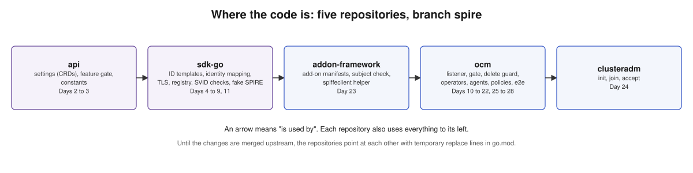

### api

| File | Holds | Commits |
| --- | --- | --- |
| [`feature/feature.go`](../../api/feature/feature.go) | The feature gate. | `aaceeb2d` |
| [`operator/v1/types_clustermanager.go`](../../api/operator/v1/types_clustermanager.go), [`funcs_clustermanager.go`](../../api/operator/v1/funcs_clustermanager.go) | Hub settings and helpers. | `aaceeb2d`, `c77b5174`, `1fa143c5`, `b805cf6c` |
| [`operator/v1/types_klusterlet.go`](../../api/operator/v1/types_klusterlet.go), [`funcs_klusterlet.go`](../../api/operator/v1/funcs_klusterlet.go) | Klusterlet settings, status, condition. | `a770a061`, `c77b5174`, `b805cf6c` |
| [`cluster/v1/types.go`](../../api/cluster/v1/types.go) | The pinning annotation. | `c77b5174` |
| `addon/v1alpha1`, `addon/v1beta1` | The `spiffe` add-on driver value. | `a770a061` |
| [`test/integration/api/`](../../api/test/integration/api/) | `clustermanager_spiffe_test.go`, `klusterlet_spiffe_test.go`. | all |

### sdk-go

| Package | Holds | Commit |
| --- | --- | --- |
| [`pkg/spiffe/idtemplate`](../../sdk-go/pkg/spiffe/idtemplate/idtemplate.go) | ID templates: check, fill in, take apart. | `3c59da31` |
| [`pkg/server/grpc/authn`](../../sdk-go/pkg/server/grpc/authn/) | `spiffeid.go` (ID to OCM identity), `spiffe.go` (authenticator, expiry checks). | `3c59da31`, `a8b06799` |
| [`pkg/testing/fakespire`](../../sdk-go/pkg/testing/fakespire/) | The fake SPIRE for tests. | `3ed6eb13` |
| [`pkg/spiffe`](../../sdk-go/pkg/spiffe/source.go) | Pick the SVID by ID. | `70c882fc` |
| [`pkg/cloudevents/generic/options/grpc`](../../sdk-go/pkg/cloudevents/generic/options/grpc/spiffeoptions.go) | The agent's connection options. | `70c882fc` |
| [`pkg/server/grpc`](../../sdk-go/pkg/server/grpc/server.go), [`pkg/server/grpc/spiffe`](../../sdk-go/pkg/server/grpc/spiffe/) | Server can take other credentials; SPIFFE credentials; connection registry. | `0ece0894` |
| [`pkg/cloudevents/server/grpc/authz/kube`](../../sdk-go/pkg/cloudevents/server/grpc/authz/kube/sar.go) | The SVID check on every event, and the hook for the hub's data-type check. | `5b1570dc`, `284a8c71` |

go-spiffe is version 2.9.0. Version 2.6.0 has a data race that the tests found.

### ocm

| Area | Files | Commits |
| --- | --- | --- |
| Hub: listener, gate, revocation | [`pkg/server/grpc/`](../../ocm/pkg/server/grpc/): `spiffe_listener.go`, `spiffe_gate.go`, `revocation.go`, `options.go` | `b851cf545`, `fa5a75dd2`, `2bdd76cff`, `05f6b541b` |
| Hub: pinning | [`pkg/server/services/cluster/cluster.go`](../../ocm/pkg/server/services/cluster/cluster.go) | `133cd8a7f` |
| Hub: delete guard | [`pkg/registration/hub/spiffe/deleteguard.go`](../../ocm/pkg/registration/hub/spiffe/deleteguard.go), `pkg/registration/hub/manager.go` | `cf7c46fb3` |
| Hub: operator | [`pkg/operator/operators/clustermanager/`](../../ocm/pkg/operator/operators/clustermanager/controllers/clustermanagercontroller/), `pkg/operator/helpers/helpers.go`, `manifests/cluster-manager/` | `6c7c8448a`, `e0e5db5b7` |
| Agents: driver, work, singleton | [`pkg/registration/register/spiffe/`](../../ocm/pkg/registration/register/spiffe/), `pkg/registration/register/grpc/clients.go`, `pkg/common/spiffe/options.go`, `pkg/work/spoke/`, `pkg/singleton/spoke/` | `a12965f16` |
| Agents: operator, four modes | [`klusterlet_controller.go`](../../ocm/pkg/operator/operators/klusterlet/controllers/klusterletcontroller/klusterlet_controller.go), `manifests/klusterlet/management/` | `8f3f94e40` |
| Admission policies and recovery | [`spiffe_admission.go`](../../ocm/pkg/operator/operators/klusterlet/controllers/klusterletcontroller/spiffe_admission.go) | `c77e17fd1`, `9b2cd94bd`, `8d1a4d175`, `301d209f2` |
| Add-on registration | [`pkg/registration/spoke/addon/registration_controller.go`](../../ocm/pkg/registration/spoke/addon/registration_controller.go) | `6c7d17fff`, `53f765407`, `544c5e266` |
| Migration | [`pkg/registration/spoke/registration/legacy_credentials.go`](../../ocm/pkg/registration/spoke/registration/legacy_credentials.go) | `acce663c2` |
| Tests | `test/integration/registration/spokecluster_spiffe_test.go`, `test/integration/util/spiffe.go`, `test/e2e/spiffe/` | `26ab1b143`, `491c69eae`, `acdb176aa` |

### addon-framework and clusteradm

| Repository | Files | Commits |
| --- | --- | --- |
| `addon-framework` | [`pkg/agent/spiffe.go`](../../addon-framework/pkg/agent/spiffe.go), [`pkg/spiffeclient/client.go`](../../addon-framework/pkg/spiffeclient/client.go), `pkg/addonmanager/controllers/registration/controller.go`, `pkg/addonmanager/controllers/agentdeploy/controller.go` | `c3b39dba` |
| `clusteradm` | `spiffe.go` in [`pkg/cmd/init`](../../clusteradm/pkg/cmd/init/spiffe.go), [`pkg/cmd/join`](../../clusteradm/pkg/cmd/join/spiffe.go), [`pkg/cmd/accept`](../../clusteradm/pkg/cmd/accept/spiffe.go) | `19d99e07`, `1c9b4a71` |

## 9. What is left

### 9.1 Work not done yet

| Item | State |
| --- | --- |
| **Day 29:** run the Default-mode lifecycle on the AKS clusters, and confirm what the design assumes about a managed platform (for example, that the built-in controllers use their own ServiceAccounts). | Not started. |
| **Day 30:** full checks in every repository, rebase, open the pull requests in order (`api`, `sdk-go`, `addon-framework`, `ocm`, `clusteradm`), update the proposal. | Not started. |
| Push the branches | `api` and `sdk-go` (up to `7541964e`) are on the fork. sdk-go `5b1570dc` and `284a8c71`, and all of `ocm`, `addon-framework` and `clusteradm`, are local only. |
| Replace lines | The repositories point at each other with temporary `replace` lines in `go.mod`. They must point at pushed commits before the pull requests. |
| Draft pull requests | None opened yet. |
| e2e checks not run | See [7.3](#73-end-to-end-tests). |

### 9.2 Open questions for review

| # | Question |
| --- | --- |
| Q11 | Which clusters does the delete guard hold? Now: pinned clusters, or all when `spiffe` is the only driver. |
| Q12 | Any SVID from a trusted SPIRE that fits the template may create a `ManagedCluster` before acceptance. Same exposure as the bootstrap token today; to be written in the proposal's risks. |
| Q13 | Add-ons with custom signer registrations or custom subjects can't work with `spiffe`. To be documented. |
| Q14 | `clusteradm init` prints a placeholder address until the hub's SPIFFE Service has a load balancer. To be decided with the AKS work. |
| Q15 | In the hosted modes, a Secret with the kubeconfig of the managed cluster still exists on the management cluster. It is not a hub credential and every driver needs it. Is that in scope of "no long-lived secrets"? |
| Q17 | Migration from `grpc` itself is not tested (the test uses `csr`). |
| Q18 | With SVIDs under 10 minutes, updates can be up to about a minute late after a reconnect. A change to the client's reconnect wait in `sdk-go` is proposed. |
| Q20 | In the hosted modes, policies on the managed cluster are checked only every five minutes. |

Details are in [`../questions.md`](../questions.md).

## 10. Related documents

| Document | What it has |
| --- | --- |
| `enhancements/.../199-spiffe-grpc-registration/README.md` | The design. |
| [`../daily-plan.md`](../daily-plan.md) | The 30-day plan as a checklist. |
| [`../days/`](../days/) | One file per day, with tasks, tests and a plain-language summary at the end. |
| [`../questions.md`](../questions.md) | Open questions, decisions and lessons. |
| [`../clusterspiffeid.md`](../clusterspiffeid.md) | How the platform team creates the SPIRE entries, per install mode. |
| [`../e2e-results.md`](../e2e-results.md) | The end-to-end results and the bugs found. |
